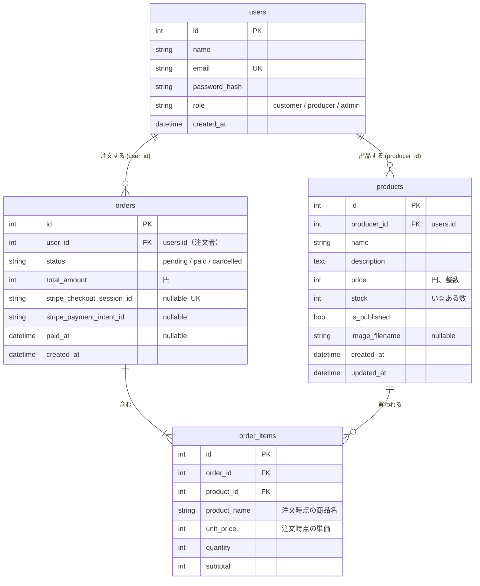

# データベース設計

[仕様書 1: 要件定義](../spec/01_requirements.md) と [画面一覧](screens.md) を実現するためのテーブル設計。テーブル名とカラム名は [仕様書 3](../spec/03_database.md) に合わせる（以降の章の指示例がこの名前で書かれているため）。

- Flask-SQLAlchemy（SQLAlchemy 2.x の `Mapped` / `mapped_column`）。開発とテストは SQLite、本番は MySQL 8.0（utf8mb4）
- カートはセッションに持つので、テーブルにしない
- 日時は日本時間（`now_jst()`）で、タイムゾーンなしで保存する
- 金額は日本円の整数（税込み）

<br>

## ER 図



<br>

## テーブル定義

### users（既存。変更なし）

| カラム | 型 | 制約 | 説明 |
|-|-|-|-|
| id | Integer | PK | |
| name | String(50) | NOT NULL | 表示名。生産者は農園名・屋号 |
| email | String(255) | NOT NULL, UNIQUE | ログイン ID。小文字にそろえて保存する |
| password_hash | String(255) | NOT NULL | `generate_password_hash` の結果。平文は保存しない |
| role | String(20) | NOT NULL, 既定 `customer` | `customer` / `producer` / `admin` |
| created_at | DateTime | NOT NULL | 登録日時 |

### products

| カラム | 型 | 制約 | 説明 |
|-|-|-|-|
| id | Integer | PK | |
| producer_id | Integer | NOT NULL, FK → users.id（RESTRICT）, INDEX | 出品した生産者 |
| name | String(50) | NOT NULL | 商品名。「ほうれん草 1束」のように量も入れる |
| description | Text | NOT NULL, 既定 `""` | 紹介文 |
| price | Integer | NOT NULL, CHECK 50〜100,000 | 税込みの価格（円） |
| stock | Integer | NOT NULL, CHECK 0〜999, 既定 0 | **いまある数**（生産者が入力する）。支払いが確定したときに減らす |
| is_published | Boolean | NOT NULL, 既定 False | 公開中か。登録直後は非公開 |
| image_filename | String(100) | NULL 可 | `marche/static/uploads/` の中のファイル名（UUID + 拡張子）。写真なしは NULL |
| created_at | DateTime | NOT NULL | 登録日時 |
| updated_at | DateTime | NOT NULL | 更新日時（更新のたびに書き換える） |

### orders

| カラム | 型 | 制約 | 説明 |
|-|-|-|-|
| id | Integer | PK | 注文番号として画面に出す |
| user_id | Integer | NOT NULL, FK → users.id（RESTRICT）, INDEX | 注文者 |
| status | String(20) | NOT NULL, 既定 `pending` | `pending`（支払い待ち）/ `paid`（支払い済み）/ `cancelled`（取り消し） |
| total_amount | Integer | NOT NULL, CHECK 0 以上 | 合計金額（円）。明細の小計の合計をサーバーで計算 |
| stripe_checkout_session_id | String(255) | NULL 可, UNIQUE | Checkout Session の ID（`cs_test_...`）。Webhook と完了ページで注文と照らし合わせる |
| stripe_payment_intent_id | String(255) | NULL 可 | 返金（拡張 E2）で使う |
| paid_at | DateTime | NULL 可 | 支払いが確定した日時 |
| created_at | DateTime | NOT NULL | 注文日時。**在庫の押さえ（35分）の起点** |

状態の移り変わり:

```text
pending（支払い待ち） ──支払い確定（Webhook か完了ページ）──▶ paid（支払い済み）
        │
        └──中断ページで取り消し（Session を期限切れにする）──▶ cancelled（取り消し）
```

- `pending` から `paid` への更新は、`pending` のときだけ更新する**条件付きの UPDATE 文**で行う（二重に確定して在庫を二重に減らさないため。[仕様書 4](../spec/04_flows_tests_seed.md)）

### order_items

| カラム | 型 | 制約 | 説明 |
|-|-|-|-|
| id | Integer | PK | |
| order_id | Integer | NOT NULL, FK → orders.id（CASCADE）, INDEX | どの注文の明細か |
| product_id | Integer | NOT NULL, FK → products.id（RESTRICT）, INDEX | 買った商品（売上の集計に使う） |
| product_name | String(50) | NOT NULL | 注文時点の商品名。あとで商品名が変わっても注文は変わらない |
| unit_price | Integer | NOT NULL, CHECK 50〜100,000 | 注文時点の単価。あとで価格が変わっても注文は変わらない |
| quantity | Integer | NOT NULL, CHECK 1〜10 | 数量 |
| subtotal | Integer | NOT NULL | `unit_price × quantity` |

- UNIQUE(order_id, product_id)。同じ注文に同じ商品を2行入れない
- 1回の注文に複数の生産者の商品が入ることがある。生産者ごとの売上は、`order_items` を `products.producer_id` で絞り、支払い済みの注文だけを集計する

<br>

## 外部キーの削除時の動き

| 外部キー | 削除時 | 理由 |
|-|-|-|
| order_items.order_id → orders | CASCADE | 明細は注文の一部で、単独では意味がないため。ORM 側も `cascade="all, delete-orphan"`（コアでは注文を消す画面はない） |
| order_items.product_id → products | RESTRICT | 注文された商品が消えると、注文の記録と売上が壊れるため。**注文がある商品は削除させず、非公開にしてもらう** |
| products.producer_id → users | RESTRICT | コアではユーザーを削除しない。誤って消して商品が宙に浮かないようにする |
| orders.user_id → users | RESTRICT | 同上。注文は支払いの記録で、消してはいけない |

- SQLite は、設定しないと外部キーの制約を確かめない（有効にするには `PRAGMA` が必要だが、このプロジェクトでは使わない）。そのため「注文がある商品は削除できない」は**ビューの中でも確かめる**。こうすると、開発・テスト・本番で同じ動き（同じメッセージ）になる。本番の MySQL（InnoDB）では DB でも止まる

<br>

## 在庫の方式

**支払い完了時に減算する方式**（仕様書 3 の方式 B）を採用する。

- `products.stock` は「生産者が入力した、いまある数」。収穫したら、いまの数に書き換えるだけでよい
- 支払いが確定したとき（Webhook か完了ページ）に、明細ごとに `stock = stock - 数量` で減らす。足りなければ 0 で止め、ログに残す
- 注文を作るとき（カート → 注文）は、減らさずに「いま買える数」で確かめるだけ。足りなければ注文を作らない

| 方式 | 中身 | 採用しない / する理由 |
|-|-|-|
| A. 毎回計算 | `stock` は「入荷した総数」。いま買える数 = 総数 − 支払い済み − 支払い待ち | 生産者が「これまでの総数」を入れる必要があり、毎日収穫して足す産直品に合わない |
| B. 支払い完了時に減算（**採用**） | `stock` は「いまある数」。支払い確定で減らす | 生産者の感覚と同じ。二重に減る欠点は、条件付きの UPDATE で防ぐ |

<br>

## いま買える数の計算

```text
いま買える数 = products.stock − （支払い待ちで、作成から35分以内の注文の、その商品の数量の合計）
```

- 計算は `marche/services/inventory.py` の `available_stock(product)` に置く。`select()` と `func.sum()` で集計し、SQLite 専用の関数（`strftime` など）は使わない。35分前の時刻は Python 側で `now_jst() - timedelta(minutes=35)` として計算し、`orders.created_at` と比べる
- 結果が 0 未満になったら 0 として扱う
- 使う場所:
  - 一覧・詳細の表示。0 なら「売り切れ」で、カートに入れるボタンを出さない
  - 商品詳細の数量のセレクト（1〜min(10, いま買える数)）
  - 注文を作るときの確認。超えていたら注文を作らない

### なぜ支払い待ちを引くのか、なぜ35分か

- 支払い待ちを引かないと、A さんが Stripe の画面でカード番号を入れている間に、B さんが最後の1個を買えてしまう
- Stripe の Checkout Session の有効期限は最短30分。時計のずれを見込んで Session は31分にし、在庫の押さえはそれより少し長い35分にする。期限が切れた決済ページでは支払えないので、35分を過ぎた支払い待ちは数えなくてよい
- 中断ページで取り消すと `cancelled` になり、押さえが戻る

### この方式で残る問題（コアでは対策しない）

- 2人が**同時に**最後の1個を注文すると、両方の注文が通ることがある（確認と作成の間に隙間がある）。支払い確定時に `stock` が足りなければ 0 で止めるが、片方は「売れたのに在庫がない」状態になる。対策（行ロック、条件付きの減算、在庫不足なら返金）は拡張 E1
- 一覧で商品ごとに集計の SQL が走る（8商品なら8回）。1回にまとめるのは拡張 E16

<br>

## 設計の判断

- status と role は `String(20)` ＋ `StrEnum`（`Role`、`OrderStatus`）。DB の Enum 型は MySQL と SQLite で動きが違うので使わない
- total_amount と subtotal を保存して、注文履歴や管理者の一覧で毎回集計しなくて済むようにする。値はデータベースの価格から計算した結果だけを入れ、フォームの値は使わない
- stripe_checkout_session_id の UNIQUE は、NULL が複数あっても SQLite でも MySQL でも問題ない
- CHECK 制約は、MySQL 8.0.16 以降と SQLite のどちらでも効く

<br>

## SQLAlchemy のモデルとリレーション

| モデル | リレーション |
|-|-|
| User | `products`（出品した商品）、`orders`（注文） |
| Product | `producer`（User）、`order_items` |
| Order | `user`（User）、`items`（OrderItem。`cascade="all, delete-orphan"`） |
| OrderItem | `order`、`product` |
